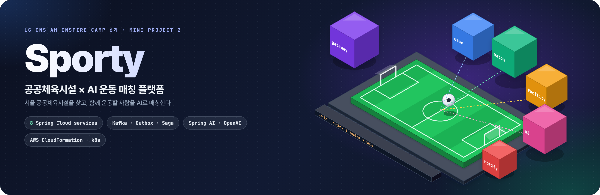
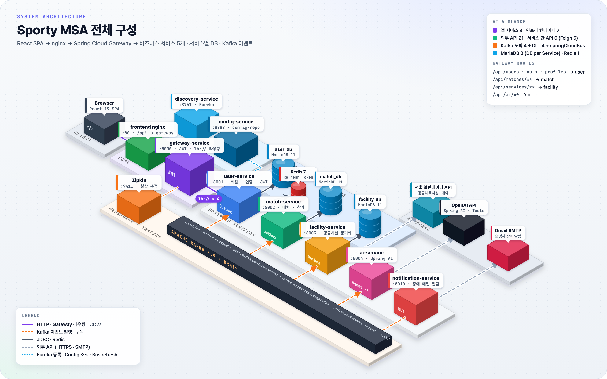
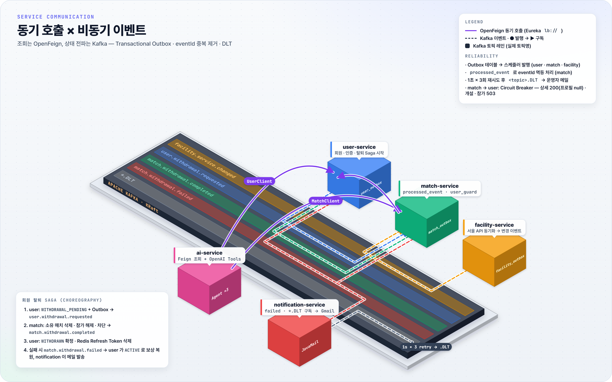
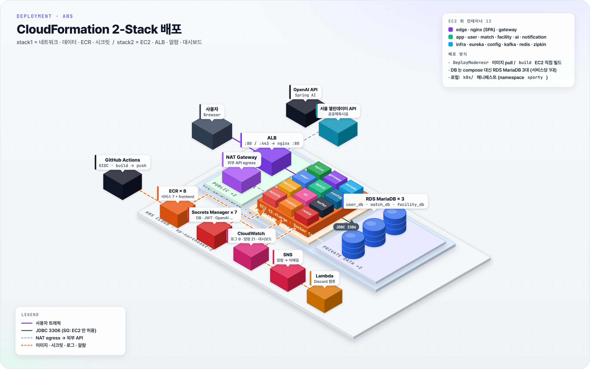

<div align="center">



# Sporty

**서울 공공체육시설 × AI 운동 매칭 플랫폼**<br>
1차 모놀리스를 **4일 만에 Spring Cloud MSA** 로 분리하고, Kafka 이벤트 · Saga · AWS 배포까지 구현한 프로젝트

LG CNS AM Inspire Camp 6기 · 미니프로젝트 2 · 1조 · 2026.11.02 – 11.05

<br>


<br>


<br>


</div>

<br>

## 목차

1. [프로젝트 소개](#프로젝트-소개)
2. [핵심 수치](#핵심-수치)
3. [주요 기능](#주요-기능)
4. [아키텍처](#아키텍처)
5. [서비스 구성](#서비스-구성)
6. [설계 원칙](#설계-원칙)
7. [요구사항 구현 현황](#요구사항-구현-현황)
8. [트러블슈팅](#트러블슈팅)
9. [테스트 · CI · 부하 테스트](#테스트--ci--부하-테스트)
10. [개발 과정 · 협업](#개발-과정--협업)
11. [빠른 실행](#빠른-실행)
12. [저장소 구조](#저장소-구조)
13. [문서](#문서)
14. [팀](#팀)

<br>

## 프로젝트 소개

**Sporty** 는 서울시 공공체육시설 정보를 바탕으로 **함께 운동할 사람을 찾고, 매치를 만들고, 참여하는** 서비스입니다.
"이번 주말 강남에서 풋살 할 사람" 같은 자연어로 매치를 검색하거나, AI 에게 매치 모집글 초안을 맡기고, 취향에 맞는 매치를 추천받을 수 있습니다. 시설 예약은 서울시 공공서비스예약 페이지로 연결합니다.

2차 프로젝트의 목표는 **1차 모놀리스(`backend/sporty`)를 기능 손실 없이 마이크로서비스로 분리**하는 것이었습니다.
1차 기능 21개와 외부 API 계약(경로 · 필드명 · 상태 코드 · 오류 코드)은 **바꾸지 않는다**는 원칙을 세워, 프론트엔드가 검사하는 값을 그대로 둔 채 백엔드만 전환했습니다.

| | 1차 (Monolith) | 2차 (MSA) |
| --- | --- | --- |
| 구조 | Spring Boot 단일 애플리케이션 | 비즈니스 5 + 플랫폼 3 = **Spring Boot 앱 8개** |
| 데이터 | 단일 DB | **서비스별 MariaDB 3대** (DB per Service) |
| 서비스 간 연동 | 메서드 호출 · JPA 조인 | **OpenFeign** 조회 + **Kafka** 이벤트 전파 |
| 회원 탈퇴 | 한 트랜잭션에서 회원 · 매치 정리 (`204`) | **Outbox + Choreography Saga**, 실패 시 보상 (`202`) |
| 인증 | 서비스 내부 JWT 필터 | **Gateway 에서 JWT 검증** 후 `X-User-Id` 전달 |
| 오류 응답 | 처리 안 된 예외가 본문 없는 `401` | `500 { message, code: null }` 공통 규칙 |
| 배포 | 로컬 실행 | Docker Compose · **Kubernetes** · **AWS CloudFormation** |

<br>

## 핵심 수치

<div align="center">

| 서비스 | 외부 API | 서비스 간 API | Kafka 토픽 | 테이블 | 자동 테스트 | 교차 테스트 |
| :---: | :---: | :---: | :---: | :---: | :---: | :---: |
| **8** | **21** | **6** | **4 + DLT** | **13** | **233** | **24 / 25** |
| 비즈니스 5 · 플랫폼 3 | 1차 계약 그대로 | Feign 5 · 수동 1 | + `springCloudBus` | 서비스 DB 3개 | `@Test` · 클래스 47 | 통과 / 전체 |

</div>

<br>

## 주요 기능

| 기능 | 설명 | 담당 서비스 |
| --- | --- | --- |
| 🏟️ **운동 매치** | 매치 개설 · 검색(조건 12개) · 상세 · 수정 · 삭제, 참가 / 참가 취소, 정원이 차면 `CLOSED` · 미달이면 `RECRUITING`, 내 매치 | match |
| 🤖 **AI 매치 도우미** | 자연어 매치 검색(조건 요약 표시), 모집글 초안 작성, 성별 · 자치구 · 선호 종목 기반 추천(최대 3개) — Spring AI Agent 3종 | ai |
| 📍 **공공체육시설 동기화** | 서울 열린데이터 API 를 기동 시 · 매일 03:00 동기화, 변경분을 Outbox → Kafka 로 match 의 시설 스냅샷에 반영 | facility |
| 🔐 **회원 · 인증** | 가입 · 로그인 · 로그아웃 · 토큰 재발급(Access 30분 · Refresh 7일, Redis `refresh:{userId}`), 프로필 · 선호 종목 | user |
| 🔁 **회원 탈퇴 Saga** | `202 Accepted` 후 user → match 로 탈퇴 전파, 매치 정리 실패 시 보상 트랜잭션으로 회원 `ACTIVE` 복원 | user · match |
| 🛡️ **장애 격리** | user-service 가 멈춰도 매치 상세는 `200`(참가자 프로필만 `null`), 시설 서비스가 멈춰도 매치 검색 · 개설 동작 | match |
| 🚨 **운영 알림** | 탈퇴 실패 · DLT 메시지를 운영자 메일로, AWS 에서는 CloudWatch 알람 → SNS → 이메일 / Discord | notification |

<br>

## 아키텍처

### System Architecture

<p align="center">
  
  <br>
  <sub>Browser → nginx → Gateway(JWT · <code>lb://</code> 라우팅) → 비즈니스 서비스 5개. 서비스마다 자기 DB 만 쓰고, 상태 변경은 Kafka 로 전파한다.</sub>
</p>

### Service Communication

<p align="center">
  
  <br>
  <sub>보라 실선은 OpenFeign 동기 호출, 점선은 실제 Kafka 토픽 기준 이벤트 흐름. Outbox · eventId 중복 제거 · DLT 로 at-least-once 전달을 안전하게 처리한다.</sub>
</p>

### Deployment (AWS)

<p align="center">
  
  <br>
  <sub>CloudFormation 2-Stack. ALB → Private Subnet 의 EC2(Docker Compose 12 컨테이너) → RDS MariaDB 3대. 외부 API 는 NAT 로만 나가고, 이미지는 GitHub Actions(OIDC) → ECR.</sub>
</p>

> 이미지는 [`docs/assets/src`](docs/assets/src) 의 HTML 소스에서 `python docs/assets/src/render.py` 로 다시 만들 수 있습니다.

<br>

## 서비스 구성

| 서비스 | 포트 | 외부 경로 | 역할 | 저장소 · 연동 |
| --- | :---: | --- | --- | --- |
| `gateway-service` | 8000 | `/api/**` | 단일 진입점, 들어온 `X-User-Id` 제거 → JWT 검증 후 다시 설정, CORS, 요청 로그, `/internal/**` 차단 | Spring Cloud Gateway |
| `discovery-service` | 8761 | – | 서비스 등록 · 조회 | Eureka |
| `config-service` | 8888 | – | `config-repo` 설정 배포(local · dev · prod), `{cipher}` 복호화, Bus refresh | Config Server · Kafka Bus |
| `user-service` | 8001 | `/api/users` · `auth` · `profiles` | 회원 · 인증 · 프로필, 탈퇴 Saga 시작 · 확정 · 보상 | `user_db` · Redis |
| `match-service` | 8002 | `/api/matches/**` | 매치 · 참가 · 모집 상태, 시설 스냅샷, 탈퇴 매치 정리 | `match_db` · Feign → user |
| `facility-service` | 8003 | `/api/services/**` | 공공체육시설 목록 · 상세, 동기화 | `facility_db` · 서울 열린데이터 API |
| `ai-service` | 8004 | `/api/ai/**` | AI 검색 · 초안 · 추천 (DB 없음) | OpenAI · Feign → match, user |
| `notification-service` | 8010 | – | `match.withdrawal.failed` · `*.DLT` → 운영자 메일 (새 컨슈머 그룹) | Gmail SMTP |

<details>
<summary><b>서비스별 DB 테이블 (13)</b></summary>

<br>

| DB | 테이블 | 비고 |
| --- | --- | --- |
| `user_db` | `user` · `profile` · `sport_preference` · `user_outbox` | `user.status` 에 `WITHDRAWAL_PENDING` · `withdrawal_saga_id` 추가 |
| `match_db` | `match` · `match_participant` · `facility_service_snapshot` · `processed_event` · `match_outbox` · `match_user_guard` | 회원 · 시설은 FK 없이 ID 값으로만 참조 |
| `facility_db` | `location` · `service` · `facility_outbox` | 비활성 시설은 지우지 않고 `active = false` |

Refresh Token 은 Redis `refresh:{userId}` (TTL 7일). 테이블은 각 서비스 JPA 가 만들고, 다른 서비스 데이터는 점선(ID 참조)으로만 가리킵니다.

</details>

<details>
<summary><b>서비스 간 API (Feign 5 + 수동 1)</b></summary>

<br>

| ID | 호출 → 제공 | 경로 | 용도 | 장애 시 |
| --- | --- | --- | --- | --- |
| IN-01 | match → user | `GET /internal/users/{userId}/status` | 매치 개설 · 참가 · 내 매치 회원 확인, Saga ID 확인 | `503 USER_SERVICE_UNAVAILABLE` |
| IN-02 | match → user | `GET /internal/users/profiles?userIds=` | 매치 상세 참가자 닉네임 · 이미지 | Circuit Breaker fallback → 상세 `200`, 프로필 `null` |
| IN-03 | ai → match | `GET /api/matches` | AI 검색 · 추천 후보 | `503 AI_DEPENDENCY_UNAVAILABLE` |
| IN-04 | ai → match | `GET /api/matches/me` | 추천에서 이미 참가한 매치 제외 | `503` |
| IN-05 | ai → user | `GET /api/users/me` | 추천용 회원 정보 | `503` |
| IN-06 | 수동 → facility | `POST /internal/facilities/sync` | 시설 동기화 수동 실행 (시연 · 스냅샷 재적재) | `500` |

타임아웃: match → user 연결 1초 · 읽기 2초, ai → match · user 연결 2초 · 읽기 3초, OpenAI 10초 (프론트 15초보다 짧게).

</details>

<br>

## 설계 원칙

- **1차 계약 유지** — 외부 API 21개의 경로 · 필드명 · 상태 코드 · 오류 code 를 그대로 두고, 바뀌는 곳(탈퇴 `202`, 신규 `503` code)만 명세에 표시했습니다. 1차 문서와 코드가 다르면 코드를 따릅니다.
- **DB per Service** — 서비스는 자기 DB 만 읽고 씁니다. 다른 서비스 데이터는 **조회 = OpenFeign**, **복제 · 상태 전파 = Kafka** 로만 가져오고, 공통 모듈 없이 응답 DTO 는 호출하는 쪽에 복사합니다.
- **Gateway 인증** — 서비스는 JWT 를 직접 보지 않습니다. 외부에서 들어온 `X-User-Id` 는 지우고 Gateway 가 검증한 값만 넣어, 토큰 없이 `X-User-Id: 999` 를 보내도 `401` 입니다. JWT 시크릿은 발급(user) · 검증(gateway)이 Config 의 같은 암호화 값을 씁니다.
- **Transactional Outbox** — 상태 변경과 이벤트를 같은 트랜잭션으로 Outbox(`PENDING`)에 쓰고, 발행기가 Kafka 로 보낸 뒤 `SENT` 로 바꿉니다. Kafka 가 멈춰도 이벤트는 쌓였다가 재발행됩니다 (user · match · facility).
- **멱등 · 순서 보호** — match 는 `processed_event` 로 eventId 중복을 무시하고, 시설 스냅샷은 `occurredAt` 이 마지막 반영 시각보다 이르면 버립니다. user 는 Saga ID 가 일치할 때만 조건부 UPDATE 합니다.
- **동시성** — 매치 참가는 비관적 락, 탈퇴 정리와 매치 개설 · 참가는 회원별 `match_user_guard` 행을 `SELECT … FOR UPDATE` 로 잠가 탈퇴 중 회원의 새 참가를 막습니다.
- **실패 격리** — Kafka 소비 실패는 1초 간격 3회 재시도 후 `<topic>.DLT` 로 보내 운영자 메일로 알립니다. 동기 호출은 Circuit Breaker 로 감싸 장애 서비스가 전체를 끌고 내려가지 않게 했습니다.
- **설정 · 비밀값** — DB 비밀번호 · JWT 키는 `config-repo` 에 `{cipher}` 로만 두고, 로컬은 `.env`, AWS 는 Secrets Manager 로 주입합니다. 설정 변경은 `/actuator/busrefresh` 로 재기동 없이 반영합니다.

<details>
<summary><b>회원 탈퇴 Saga 흐름 (EV-02 ~ EV-04)</b></summary>

<br>

1. **user** — 비밀번호 확인 → `WITHDRAWAL_PENDING` + `withdrawal_saga_id` 저장 + `user_outbox` 에 `user.withdrawal.requested` 기록 (한 트랜잭션, `202 Accepted`)
2. **match** — eventId 중복 · Saga ID 일치 확인 → 회원 Guard 잠금 → 소유 매치 삭제 · 참가 정리 · Guard 차단 · 처리 이력 · `match.withdrawal.completed` Outbox 를 한 트랜잭션으로 기록
3. **user** — Saga 가 일치할 때만 `WITHDRAWN` 확정, Redis Refresh Token 삭제
4. **실패 시** — 정리를 롤백하고 재시도, 끝내 실패하면 롤백을 확인한 뒤에만 `match.withdrawal.failed` 기록 → user 가 `ACTIVE` 로 복원(Refresh Token 유지), notification 이 운영자 메일 발송. 커밋 결과가 불명확하면 보상 이벤트를 만들지 않고 DLT · 운영자 조사로 넘깁니다.

`saga.fail-cleanup=true` 로 실패를 일부러 주입해 보상 경로를 시연했고, 늦게 도착한 성공 / 실패 이벤트 · 다른 Saga 의 이벤트에도 상태가 깨지지 않는지 자동 테스트와 실제 Kafka · MariaDB · Redis 통합 검증으로 확인했습니다 ([W-22](docs/w22-integration-result.md), [W-32](docs/w32-integration-result.md)).

</details>

<br>

## 요구사항 구현 현황

기능 요구사항 21개(1차 그대로)에 더해, MSA 핵심 요구사항 10개와 선택 요구사항을 구현했습니다.

| ID | 요구사항 | 구현 |
| --- | --- | --- |
| MSA-01 | 마이크로서비스 분리 | 앱 1개 → 업무 4 + Gateway · Eureka · Config (+ 알림 서비스) |
| MSA-02 | Service Discovery | 전 서비스 Eureka 등록, `lb://` 라우팅 |
| MSA-03 | API Gateway | 라우팅 · JWT 검증 · `X-User-Id` 재설정 · CORS · 요청 로그 · `/internal` 차단 |
| MSA-04 | Config 중앙화 | `config-repo` 공통 · 서비스별 설정, 프로필 local · dev · prod |
| MSA-05 | 동기 통신 | OpenFeign IN-01 ~ IN-05 |
| MSA-06 | 비동기 통신 | Kafka 토픽 4개 (EV-01 ~ EV-04) + DLT |
| MSA-07 | 도메인 API | 매치 CRUD + `RECRUITING ↔ CLOSED` |
| MSA-08 | 서비스별 DB | MariaDB 3대 (로컬 3306 · 3307 · 3308, AWS RDS 3대) |
| MSA-09 | 컨테이너화 | 서비스별 Dockerfile → 생성형 master Dockerfile, Compose 전체 기동 |
| MSA-10 | 핵심 차별화 기술 | 시설 변경 → 매치 복제(EV-01): Outbox 발행, 재시도 · 중복 무시 · DLT, 시설 서비스 · Kafka 중지 시나리오 |
| OPT-01 | Spring Cloud Bus | `/actuator/busrefresh` 일괄 갱신 |
| OPT-02 | 설정 암호화 | Config `{cipher}` (DB 비밀번호 · JWT 시크릿) |
| OPT-03 | Kubernetes | `k8s/` 매니페스트, 로컬 클러스터에 전체 스택 |
| OPT-04 | 클라우드 배포 | AWS CloudFormation 2-Stack (EC2 · ALB · RDS · ECR · CloudWatch) |
| OPT-05 | Circuit Breaker | user-service 중지 시 매치 상세 `200`, `CLOSED → OPEN → HALF_OPEN → CLOSED` 확인 |
| OPT-06 | 분산 추적 | Micrometer Tracing + Zipkin, 한 요청 = 트레이스 하나 |
| OPT-07 | 부하 테스트 | k6 시나리오 6종 작성 (1차 · 2차 동일 시나리오 비교용) |
| OPT-10 | Saga 보상 | 회원 탈퇴 EV-02 ~ EV-04, 실패 시 `ACTIVE` 복원 |
| 추가 | 운영 알림 | 탈퇴 실패 · DLT → 운영자 메일 (기존 서비스 코드 변경 없이 새 컨슈머 그룹) |

<br>

## 트러블슈팅

| 문제 | 원인 | 해결 |
| --- | --- | --- |
| 1차에서 검증 실패 · 깨진 JSON · 서버 오류가 모두 본문 없는 `401` | 처리 안 된 예외가 `/error` 로 넘어가고, `/error` 가 인증 필터에 막힘 | 2차 공통 규칙: `/error` · `/internal/**` 공개(user · match), 처리 안 된 예외는 `500 { message, code: null }` |
| 동시 탈퇴 요청이 MariaDB 에서만 `202 + 500` | H2 테스트는 통과했지만 MariaDB 에서 두 트랜잭션이 같은 회원 행을 조건부 UPDATE 하며 `SQL Error 1020 (Record has changed since last read)` | 탈퇴 접수 첫 조회를 `SELECT … FOR UPDATE` 로 바꿔 같은 회원 요청을 직렬화 → `202 + 409 WITHDRAWAL_ALREADY_PENDING` ([W-22](docs/w22-integration-result.md)) |
| 서비스가 꺼져 있을 때 Gateway 응답이 오래 걸림 | 내려간 인스턴스로 연결을 기본 타임아웃만큼 기다림 | Gateway 연결 대기를 2초로 제한해 빠르게 실패 (#49) |
| Compose · ALB 헬스체크 실패 | 각 서비스 SecurityConfig 가 `/actuator/health` 까지 401 로 막음 | 헬스 경로 공개, Compose `depends_on: service_healthy` 로 기동 순서 보장 ([W-13](docs/w13-integration.md)) |
| match 를 2대로 늘리면 이벤트 중복 발행 | 두 인스턴스의 Outbox 스케줄러가 같은 행을 동시에 발행 | match 는 replica 1 · `Recreate` 전략으로 고정하고 소비 측 eventId 중복 제거 유지 ([k8s](k8s/README.md)) |
| Bus refresh 한 번에 user-service 설정이 세 번 갱신 | Bus 바인더 producer 직렬화가 기존 String 직렬화와 충돌 | `config-repo/user-service.yml` 에 `ByteArraySerializer` 명시, config 서버 다운 시에도 `@Value` 기본값으로 기동 (OPT-01) |
| EC2 첫 배포에서 이미지 7개 중 다수 빌드 실패 | 빈 캐시에서 병렬 빌드 시 `Timeout waiting to lock journal cache` | Dockerfile 의 Gradle 캐시 마운트를 `sharing=locked` 로, `deploy.sh` 는 갱신 후 새 스크립트로 재시작 (W-35, [deploy.md](docs/deploy.md)) |

<br>

## 테스트 · CI · 부하 테스트

- **교차 테스트** — 기능 21개 + 장애 장면 4개, 총 25개 테스트 케이스를 **만든 사람이 아닌 팀원이** 전체 Compose 스택에서 Gateway(8000)로 수행. 24건 통과, Kafka 중지 복구(TC-24) 1건 미수행
- **단위 · 통합 테스트** — 서비스별 JUnit 5 테스트 233건, Saga · Kafka 는 실제 Kafka · MariaDB · Redis 로 통합 검증 후 결과 문서화
- **CI** ([`ci.yml`](.github/workflows/ci.yml)) — PR · push 마다 8개 서비스 매트릭스 `compileJava` / `compileTestJava`, 서비스별 Docker 이미지 빌드, 생성형 master Dockerfile 동기화 검사, 프론트 `npm test` · `npm run build`
- **MSA 파이프라인 테스트** ([`tests/pipeline`](tests/pipeline)) — gateway · user · match · facility · ai · resilience · events · saga 8개 스위트를 실제 스택에 실행
- **부하 · 장애 테스트** ([`tests/load`](tests/load)) — k6 `smoke · average · stress · spike · soak · chaos` 시나리오, `chaos.sh` 로 컨테이너를 멈춰 장애 주입. 1차 모놀리스에도 같은 스크립트를 돌릴 수 있게 작성
- **배포 스모크** — [`deploy/ec2/smoke.sh`](deploy/ec2/smoke.sh) 가 nginx → gateway → 각 서비스, 가입 → 로그인 → 인증 API 까지 확인

<br>

## 개발 과정 · 협업

| 날짜 | 단계 | 주요 작업 |
| --- | --- | --- |
| 11/2 (월) | 초기 세팅 | 킥오프 · 명세 확정, 서비스 7개 Gradle 골격, Eureka · Config, 로컬 인프라 Compose, 1차 코드 이동(user · match · facility · ai), `X-User-Id` 필터, Gateway 라우팅 · JWT |
| 11/3 (화) | 서비스 연결 | 1차 통합, 회원 내부 API · Feign + Circuit Breaker, 시설 Outbox 발행 · 스냅샷 구독, AI Feign, 탈퇴 Saga 성공 경로, 공용 Dockerfile, Config 이전 · 암호화, AWS 배포 계획 |
| 11/4 (수) | 핵심 기술 · 통합 | Kafka 재시도 · 중복 무시 · DLT, Saga 보상 + 실패 주입, Zipkin, 전체 스택 Compose, AWS 배포, 시연 데이터, Kubernetes, 운영자 메일 알림, 교차 테스트, 코드 동결 |
| 11/5 (목) | 제출 · 발표 | 산출물 · 결과보고서 · 시연 영상 · 발표 |

- **명세 우선** — 서비스 목록 · API · DTO 필드 · 서비스 간 API · 이벤트 · DB 테이블 · 오류 코드 · WBS · 테스트 케이스 · 증빙을 팀 공유 시트로 먼저 확정하고, 칸마다 `확정 / 미정 / 보류` 상태로 관리했습니다. 명세 변경은 상대 담당 + 명세 담당 합의 후에만 반영합니다.
- **리뷰 규칙** — `develop` 에서 `feat/{서비스}-{작업}` 분기 → `[W-xx]` 커밋 · PR → CODEOWNERS 자동 지정 리뷰어 1명 이상 승인 후 머지 ([CONTRIBUTING.md](CONTRIBUTING.md)).
- **막힘 해소** — 선행 작업이 끝나지 않았으면 가짜 응답 · 서비스 포트 직접 호출로 먼저 진행하고, 막히면 작업 ID · 에러 문구 · 시도한 것을 공유했습니다.

<br>

## 빠른 실행

Docker Desktop 만 있으면 전체 스택(앱 8 + nginx + 인프라 7)을 띄울 수 있습니다.

```bash
cp .env.example .env && cp backend/.env.example backend/.env
docker compose -f compose.yaml -f compose.app.yaml up -d --build --wait
bash deploy/ec2/smoke.sh http://localhost
```

| 주소 | |
| --- | --- |
| <http://localhost> | 프론트엔드 |
| <http://localhost:8761> | Eureka 대시보드 |
| <http://localhost:9411> | Zipkin |

IDE 실행, 환경변수 위치, 1차 모놀리스 실행은 [docs/SETUP.md](docs/SETUP.md), AWS 배포는 [docs/deploy.md](docs/deploy.md) · [infra/aws/README.md](infra/aws/README.md), Kubernetes 는 [k8s/README.md](k8s/README.md) 를 봅니다.

<br>

## 저장소 구조

```text
.
├── backend/                 Gradle 멀티 프로젝트
│   ├── gateway-service/     discovery-service/   config-service/
│   ├── user-service/        match-service/       facility-service/
│   ├── ai-service/          notification-service/
│   └── sporty/              1차 모놀리스 (분리 원본)
├── frontend/                React 19 SPA (CRA) + nginx 이미지
├── config-repo/             서비스별 설정 (dev · prod 프로파일, {cipher})
├── compose*.yaml            로컬 인프라 · 앱 · AWS · ECR · CloudWatch 로그 오버레이
├── k8s/                     namespace sporty 매니페스트 (00 ~ 50) + up · verify · down
├── infra/aws/               CloudFormation stack1(네트워크 · 데이터) · stack2(앱)
├── deploy/ec2/              bootstrap · deploy · smoke 스크립트
├── tests/                   pipeline 통합 스위트 · k6 부하 테스트
└── docs/                    통합 검증 결과 · 1차 산출물 · README 이미지
```

<br>

## 문서

| 문서 | 내용 |
| --- | --- |
| [docs/SETUP.md](docs/SETUP.md) | 로컬 실행 가이드 (MSA · 모놀리스) |
| [docs/deploy.md](docs/deploy.md) | AWS 배포 설계와 절차 |
| [docs/w13-integration.md](docs/w13-integration.md) | 첫 통합 확인 (프론트 → Gateway → 서비스) |
| [docs/w22-integration-result.md](docs/w22-integration-result.md) | 회원 탈퇴 Saga 통합 검증 |
| [docs/w32-integration-result.md](docs/w32-integration-result.md) | 탈퇴 실패 보상 통합 검증 |
| [docs/w49-notification.md](docs/w49-notification.md) | 운영자 메일 알림 설정 |
| [docs/deliverables](docs/deliverables) | 1차 프로젝트 산출물 (요구사항 명세서 · ERD · 화면설계도 · 테스트 케이스 등) |
| [CONTRIBUTING.md](CONTRIBUTING.md) | 브랜치 · 커밋 · PR · 리뷰 규칙 |

<br>

## 팀

<div align="center">

|  |  |  |  |
| :---: | :---: | :---: | :---: |
| **신해원** · 조장 | **민경완** | **반정욱** | **김우석** |
| 일정 · 범위 · 산출물 · Kubernetes | API · 이벤트 명세 · Circuit Breaker · Saga 보상 · 메일 알림 | 테크리드 · Compose · CI · AWS 배포 | Gateway · Eureka · Config · 설정 암호화 |
| [@bapzzi](https://github.com/bapzzi) | [@livelykitten](https://github.com/livelykitten) | [@salieri009](https://github.com/salieri009) | [@woo1956](https://github.com/woo1956) |
|  |  |  |  |
| **송석주** | **김예림** | **이서현** | **서정운** |
| user-service · `X-User-Id` 필터 · 탈퇴 Saga | match-service · 시설 스냅샷 · Kafka 재시도 · DLT | facility-service · Outbox 발행 · Cloud Bus | ai-service · Zipkin 분산 추적 |
| [@songsj27](https://github.com/songsj27) | [@kimrim818-afk](https://github.com/kimrim818-afk) | [@seohynee](https://github.com/seohynee) | [@Jeonun-real](https://github.com/Jeonun-real) |

</div>
